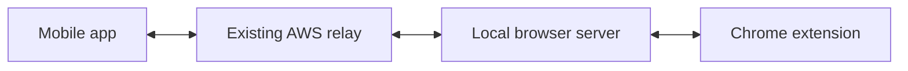

# MCP Browser Extension mobile app

Updated: 2026-10-31

The owner approved the two-stage app plan and requested our best product design. The app should feel polished, distinctive and complete, while remaining easy for an ordinary person to use.

This document is the working product plan. The pairing protocol is documented separately in [PHONE-PAIRING.md](PHONE-PAIRING.md).

## What we are building

A mobile app that connects to the person's computer through a QR code in the Chrome extension. The person approves the phone on the computer, and the app remembers that connection.

The first version will connect to the owner's existing AWS relay and computer. A service for many users remains a later project.

The app operates Chrome on the computer. The computer must remain awake, with Chrome and the local server running.

## What is already built

- The extension popup has Phone access, Pair phone and Generate QR code in the local build.
- QR invitations last two minutes and can be used once.
- Scanning creates a request. Matching a six-digit number and approving in Chrome grants access.
- Each phone receives its own credential, valid for 30 days, with Remove access available in the extension.
- Phone access is restricted to the paired browser profile and the websites already allowed there.
- The local relay helper has been updated, including the personal chat endpoint. The existing public relay forwards pairing requests without an AWS or website deployment change.
- Automated tests covered QR decoding, approval, browser use and removal with a simulated phone client.

The first mobile implementation now lives in `~/Work/mcp-browser-extension-mobile`. On 2026-10-31 the owner selected both Android and iPhone for testing. The app uses React Native with Expo, with shared connection logic and native camera and secure storage integrations.

Welcome, scanning, number comparison, connected computer, tab search, captured page view, formatted reading view, browser chat and connection settings are implemented. The app handles saved and pending pairings, foreground reconnection, offline computers, removed access and local forgetting. It includes light and dark themes, reduced motion and accessible controls. Manual appearance selection currently lasts for the app session.

Typecheck, 27 protocol/controller/backend tests and eight headless interface tests pass. The backend test uses the actual local pairing and MCP server with a disposable browser stub. Interface checks cover phone sizes, landscape, tablets and both themes. Android and iOS Hermes bundles and the web bundle export successfully; Expo reports compatible dependency versions.

The owner opened the app in Expo Go on Android and reported seeing tabs and page text. iPhone acceptance, saved reconnection and desktop removal on real phones still need testing. Neither platform has a compiled, signed native build. Xcode and the Android SDK are not installed on this Mac. Reloading and inspecting the new popup in the owner's live Chrome also remains unverified because the browser tool connection was closed. These are separate from the completed automated tests. Stage one remains in acceptance testing until both real phones complete the flow below.

Expo's CLI/configuration dependency tree currently has eight audit advisories, including three high-severity entries inherited through Zod. Resolve or reassess compatible upstream fixes before release; do not force a major Expo downgrade to silence the audit.

## The intended experience

1. Open the mobile app and tap **Connect computer**.
2. Scan the QR shown in the extension popup.
3. Compare the number shown on the phone and computer, then click **Allow this phone** in Chrome.
4. See the computer name and **Connected** on the phone.
5. Browse the computer’s open tabs, view a captured page or switch to reading view.
6. Tap the floating chat button at the bottom-right to send a request through Codex on the Mac. Minimize with the down arrow to see tabs again; the conversation and draft stay in memory.
7. Return later and reconnect using the saved pairing while it remains valid.

Setup must work through clear screens and buttons. Users should not need to find private links in logs, copy credentials, edit configuration files or run commands on their phone.

## Stage one: connect and use the browser

Build the complete pairing experience and a useful browser interface before adding conversational commands.

| Screen | Purpose | Main action |
| --- | --- | --- |
| Welcome | Explain that the phone will connect to Chrome on the computer | Connect computer |
| Scan | Scan the invitation and explain camera access when needed | Scan QR |
| Confirm | Show the matching number and wait for desktop approval | Review the number on the computer |
| Computer | Show the saved computer and its current connection status | Open browser |
| Browser | Show open tabs, page titles and readable page content | Select a tab or read a page |
| Connection settings | Explain access expiry and manage the saved connection | Disconnect or forget this computer |

Use the existing pairing contract:

1. Validate the QR version, expiry and trusted HTTPS service address.
2. Claim the invitation and save the returned credential in the phone's secure storage.
3. Poll for approval and show the matching confirmation number.
4. Open an MCP connection after approval.
5. List tabs and read a selected page through the existing browser tools.
6. Restore the connection when the app returns to the foreground. Handle an expired or revoked credential by offering to pair again.

Keep secrets out of URLs, ordinary app preferences, logs and analytics. The desktop's private pairing controller stays private; the phone uses the public pairing and MCP endpoints.

Distinguish **Disconnect**, which ends the current mobile connection, from **Forget this computer**, which clears the phone's saved credential. The extension's **Remove access** revokes the credential on the computer. Do not label a local deletion as server-side revocation.

Stage one is complete when a real phone can scan, receive approval, list tabs, read a page, reconnect after reopening the app, and lose access when the owner removes it in Chrome.

## Stage two: conversational tasks

Add a chat experience where the person can type a request such as “Open this website and summarize it.” Show what is happening, which computer is being used, and the result.

Pairing supplies browser access. A model or agent must separately interpret the person's request and call the browser tools.

On 2026-10-31 the owner selected chat inside the mobile app. He clarified that it should use his existing Codex access for now, not this development conversation and not a separate OpenAI API key.

The personal implementation runs Codex app-server on the paired Mac under its existing ChatGPT sign-in. Each phone gets an independent ephemeral conversation. Requests use the existing pairing bearer through the relay; browser tools run under that same phone identity and website restrictions. The Codex login remains local. The phone shows formatted replies, progress, Stop and New chat. The Mac must stay awake, and Codex usage limits apply.

The adapter disables inherited MCP integrations, plugins, other apps, shell and independent browser tools. Browser actions pass through the extension. Conversations are memory-only, bounded, and expire after 30 minutes without requests. Stop terminates the chat process; the next conversation starts through New chat. Removal also stops that phone's process. An action already executing may finish.

The personal connection is not authorization for a commercial or hosted service using the owner's account. Public sign-in, multi-user hosting and distribution remain separate work.

## Design direction

Give the mobile app a strong visual identity and the finish of a carefully designed native product. Simplicity means clear navigation and few setup steps; the visual design should receive full attention from the first stage.

The working direction is a calm, confident browser companion:

- Use deep ink surfaces in dark mode and soft ivory surfaces in light mode, with a precise blue accent for primary actions and focus.
- Give the connected computer a recognizable presence through its name, a restrained device illustration or icon, and a clearly written status.
- Use deliberate typography, generous spacing and clear hierarchy. Make page titles and readable content the focus of the browser screen.
- Design the scanner as a focused camera view with a clear frame and short instructions. Give number comparison its own prominent treatment.
- Show tabs as readable rows with site identity and useful context. Keep the main action within comfortable thumb reach.
- Use subtle motion to explain scanning, connection progress and completion. Respect reduced-motion preferences.
- Design loading, empty, offline, expired, denied and revoked states with the same care as successful screens.
- Support larger text, screen readers, sufficient contrast and comfortable touch targets. Status must be understandable without relying on color.
- Use the existing product identity where appropriate. Apply this new visual direction to the mobile app; retain the existing extension appearance and the user's website themes.

Technical identifiers, tokens and relay configuration belong behind the interface. Display details only when they help the person understand or resolve a problem.

## Implementation sequence

1. Define the screen flow, visual foundations and reusable components for the mobile app.
2. Choose the first phone platform and framework, then create the app project.
3. Implement camera scanning, number comparison, approval waiting and secure credential storage.
4. Integrate the existing MCP connection, tab list and page reading.
5. Complete reconnection, offline handling, access expiry and removal behavior.
6. Test on the owner's phone using the current AWS setup and finish the interface details.
7. Choose the conversation approach and build stage two.

Android and iPhone are both selected, and React Native with Expo is implemented. Steps 1 through 5 have a local implementation and automated coverage. Step 6, testing both actual phones with the current AWS setup, is next. Step 7 now has the personal Codex-backed chat implementation; phone acceptance is still required.

For development, the Expo QR opens the app on the phone. The separate QR in the extension pairs the computer after the app is open. End users of a future installed release will only need the extension pairing QR. Development startup and test commands are in the mobile project's `README.md`.

## Validation and continuation

Test genuine camera scanning, declined camera permission, an invalid QR, an expired invitation, a mismatched confirmation number, desktop denial, network loss, computer sleep, app reopening, credential expiry and desktop removal. Browser actions must continue to respect the existing profile and website restrictions.

Use disposable background browser fixtures for automated checks. A successful simulation does not substitute for a test on the actual phone. Do not display simulated results as live browser data.

Keep this plan and the shared agent memory current as decisions are made. Preserve existing work, and obtain the owner's explicit approval at the time of any commit, push, release or publication.

## Latest acceptance check: 2026-10-31

The local chat helper is installed and enabled on the owner's Mac. Its original version and launch-agent configuration have rollback copies. A real signed-in Codex test called a disposable browser fixture, returned the result and retained context on a second turn. All 614 desktop unit/browser checks and 195 headless E2E checks pass, with one Windows-only skip in the unit run. Mobile validation is 27 core/backend checks, nine UI checks and successful Android/iOS/web exports.

The owner reported a connection/offline loop while the new chat UI was talking to the older helper. The helper is now updated. The phone now checks the pairing endpoint before treating a missing chat route as revoked access, and a regression test covers the mismatch. Actual phone chat acceptance and iPhone testing are still pending.

The owner clarified that slowness affects typing, scrolling and taps, and requested a chat icon like Settings. The owner then clarified that he means a floating button. Chat now opens as a modal from a round button at the bottom-right, anchored while scrolling and above footer controls. The down arrow minimizes it back to browsing, preserving the conversation, draft and current page. Opening from Home places the tab list underneath. Running requests continue while minimized with slower progress checks; idle hidden chats stop polling, and app backgrounding pauses network work. Typing no longer redraws the transcript, unchanged messages are reused, and tab rows use memoization with deferred search. Returning from chat does not recapture the page or reload reading content. Automated coverage passes for these flows, including small phones and landscape. Actual device smoothness has not been measured; check it on the owner's phone before claiming the reported lag is resolved.

The owner reported too much empty space and awkward controls in the Chrome page view on 2026-10-31. It now uses a compact address bar, an edge-to-edge viewer and one labelled toolbar for desktop scrolling and local zoom. The owner subsequently requested a default zoom of 100%, superseding automatic enlargement to fill the viewer. The entire capture is visible initially, and Fit restores that 100% size. Manual zoom is preserved when returning from chat. The floating chat button remains above the toolbar. Hidden-screen layout events no longer shrink the preview. This remains a captured desktop image, not an interactive website or video stream.

On 2026-10-31 the owner clarified that the phone keyboard covers the chat message box or Send button. The initial React Native keyboard-avoidance change was superseded by Expo-compatible react-native-keyboard-controller, Reanimated and Worklets. A root KeyboardProvider and automaticOffset padding track native movement and modal position; the composer stays below the transcript with a fixed Send/Stop target. Compact headers and bounded multiline input preserve room for typing. All 27 core/backend tests, eight interface tests, typecheck, Expo dependency check and Android/iOS/web exports pass. A native check on the connected Android phone confirmed that the composer ends at the keyboard edge and both input and Send sit above it; hiding the keyboard restored the bottom placement. iPhone keyboard acceptance remains pending.

The owner then asked for chat to open at the end and clarified that messages should use a ChatGPT-style mobile layout with neither sender names nor icons. User messages now use neutral rounded bubbles on the right, with plain formatted replies on the left and a round Send/Stop button. Opening, reopening and sending go to the newest message; deliberate scrolling up preserves the visible reply as new content arrives. A 60-message fixture verifies these behaviors in both themes and with a smaller keyboard-sized viewport. Automatic scrolling no longer dismisses the web fixture's input. Final mobile validation is typecheck, all 27 core/backend tests, nine UI tests and Android/iOS/web bundle exports. The latest conversation appearance still needs owner acceptance on the phone.

On 2026-10-31 the owner asked to fix slow chat and tabs refusing to come forward. The helper no longer overrides tab_select show or tab_new active to false; its instructions honor explicit open/show requests while leaving background reading alone. The extension selects the requested tab and focuses its window. Mobile chat uses GPT-6.1 Terra with low reasoning when the account catalog supports it, otherwise the catalog default and supported effort, without changing the owner's development settings. Repeated desktop onboarding text was removed from the model's tool descriptions while retaining server enforcement.

Outgoing messages are visible before network acknowledgement, with an honest sending state. Versioned status requests wait for changed text/activity for up to 15 seconds, eliminating the fixed update delay. Older helpers retain timed polling; errors back off, backgrounding cancels waits, and interrupted sends retain their request ID. Deferred transcript updates preserve typing responsiveness. Tests cover visible/background tab requests, actual tab and window focus in headless Chromium, status cancellation/reset/revocation, immediate sending, stale responses and reconnect idempotency.

Final validation for these changes: 617 desktop unit/browser checks pass, with one Windows-only skip; all 195 headless E2E checks, 30 mobile core/backend tests and nine mobile UI tests pass. Desktop/extension/mobile typechecks and Android/iOS/web bundle exports pass. A real signed-in model used a disposable browser to correctly handle "Can you open my npm?" with visible selection. A cold fixture command took about 6.4 seconds; a follow-up context reply took about 1.2 seconds in a separate run. These are local fixture measurements, not a phone-network latency guarantee.

The tested helper files and extension bundle were copied into the stable installation, backed up under ~/.mcp-browser-extension/before-chat-speed-2026-10-30T23-02-10-207Z, and launchd restarted successfully. The helper listens on loopback 38118; installed file hashes match the tested build. The live development Chrome MCP transport is closed. A one-time Reload of the unpacked extension was requested from the owner so the new window-focus behavior is active. The phone reload helper will not discard a draft or active request. No commit, push, release, AWS change or publication occurred.

After the request finished and the draft was empty, the guarded native reload succeeded. The connected Android runtime now exposes the new outgoing-message state, and Browser Chat was reopened for the owner. The owner confirmed the one-time Chrome extension Reload on 2026-10-31.

On 2026-10-31 the owner replied "done" to the requested Chrome extension Reload. The local helper was confirmed running on port 38118 afterwards. The development Chrome MCP transport remained closed and the phone inspector was not connected, so the final live phone/tab-focus result still needs owner acceptance; do not ask them to repeat the completed extension Reload.

On 2026-10-31 the owner reported that the assistant's replies said the connection dropped while the phone still showed Connected. The native app reported a ready chat and 24 tabs. The helper's action log showed successful tab listing and snapshots, followed by repeated read_as_markdown failures reporting NO_BACKEND. A disposable Chromium page with 5 MiB of embedded JSON reproduced the disconnect: get_html sent a result larger than the bridge's 4 MiB WebSocket limit, closing the shared browser connection.

The extension now checks each encoded command response against the same byte limit and returns RESULT_TOO_LARGE without closing the socket. Page reading falls back to visible text for this specific error, preserving the selected tab, selector, frame and website checks. Raw HTML remains explicitly bounded; unrelated failures are not retried as text. A marker in the error supports an older shared bridge that does not know the new error code. Regression coverage checks byte expansion from Unicode and JSON escaping, recovery on the same socket, and complete readable text from the large-page fixture.

Final validation for the large-page fix: 631 unit/browser checks pass, one Windows-only skip, all 203 headless E2E checks pass, and all 30 mobile core/backend checks pass. Desktop build/typecheck, extension typecheck and diff whitespace checks pass. Installed only the compiled helpers and connection modules plus the background worker into the stable helper; the rollback copy is ~/.mcp-browser-extension/before-large-page-fix-20261031T002811Z. Installed hashes match the tested build. The helper restarted on port 38118 as PID 12991 after the phone's active request completed. A subsequent native check showed connected/ready with 23 tabs, and the phone's action log confirmed successful tab selection. A page-reading attempt still failed with NO_BACKEND before the new worker reload was confirmed. The owner has been asked to Reload the extension for this separate fix and retry. The development MCP transport remains closed; live acceptance is pending. Nothing was committed or published.

Subsequent phone action metadata at 2026-10-31 00:35:06 UTC confirms tab_select and read_as_markdown both succeeded. This is evidence of a successful live page read after the prior disconnect fix; no additional extension reload should be requested for that completed step.

The owner then shared a mobile reply saying drawing was unavailable. The existing extension already supports real mouse strokes through `draw`, but the mobile chat's explicit tool list omitted it. Added `draw` and canvas instructions to inspect the page, select its drawing tool, use viewport CSS coordinates and verify the outcome. A regression test checks tool exposure, execution under the paired identity, and refusal when mutations or website access are disabled. Final validation: 633 unit/browser checks, 203 headless E2E checks and 30 mobile core/backend checks pass, with one Windows-only unit skip. The browser test verifies painted canvas pixels from real mouse strokes. Desktop build, extension typecheck and diff checks pass. Installed only compiled phone-chat.js/.d.ts into the stable helper, verified hashes and restarted it as PID 17464 after the phone request was idle. Backup: ~/.mcp-browser-extension/before-mobile-draw-20261031T004556Z. A new chat receives the updated catalog; the actual requested portrait remains for phone acceptance. No extension reload is needed for this helper-only change. Nothing committed or published.

On 2026-10-31 the owner requested a complete tool audit after drawing was added. Mobile chat had exposed 18 of the 38 tools available to an approved phone. It now uses the authenticated MCP catalog directly, restoring the other 20 enabled tools without a separate chat allowlist. This includes hovering, form filling, iframe controls, waits, text/HTML/link extraction, page checkpoints, page scripts, browser observers, downloads, uploads, PDFs and batches. Browser capability flags, explicit tool restrictions, website permissions and phone identity still apply, including to nested batch operations. The five profile/task management tools remain unavailable to phones. Chat never receives shell or general filesystem access. Saved page checkpoints now use each phone's private workspace instead of sharing desktop or other phones' checkpoints.

The owner's later portrait screenshot showed a quality limitation, and bounded phone action metadata also revealed a draw call timing out after 20 seconds despite earlier successful drawings. Drawing now has a size-based command budget capped at four minutes, with the existing 20-second deadline applied to each stalled input event. Interrupted drawings report completed strokes and are never automatically replayed after debugger detachment. A headless regression completes a real canvas stroke taking more than 20 seconds; another forces a mid-stroke disconnect and verifies that the stroke is not replayed. The chat tool timeout is five minutes, matching its existing turn deadline.

Image generation and image editing are not connected to mobile chat. Freehand control does not guarantee a convincing portrait. Phone file selection and direct delivery of computer downloads/PDFs to the phone are also unbuilt; browser uploads use requested files inside the computer's configured upload directory. These are separate product features, not hidden browser tools to enable.

Final combined validation on 2026-10-31: 641 unit/browser checks pass, including gated extension smoke/restart checks; one Windows-only check is skipped. All 205 headless E2E checks, 30 mobile core/backend checks and nine mobile UI checks pass. Extension/mobile typechecks, Expo dependency compatibility and Android/iOS/web exports pass. A signed-in model used hover and get_text through a disposable paired browser fixture. The mobile scrolling test now observes reply delivery through visible activity, then verifies the new message on reopening; it does not require a virtualized off-screen row to remain mounted. No mobile production UI code changed in this audit.

Installed 15 verified compiled files on 2026-10-31, including the concurrent extension install-identity fix. Replaced helper protocol, extension-executor, tools and phone-chat modules plus background.js in all three existing extension locations, preserving manifests and pairing files. Backup: ~/.mcp-browser-extension/before-mobile-catalog-20261031T012637Z. The helper restarted successfully as PID 32169 on loopback 38118. A fresh chat receives all enabled tools; the new drawing timeout requires one extension Reload to activate the worker. The phone retained its saved computer, briefly reported offline after the restart, then reconnected with four tabs and no chat error. New-worker acceptance still requires an extension Reload. The development MCP transport is still closed. iPhone device acceptance and portrait quality are not verified. Nothing committed or published.
